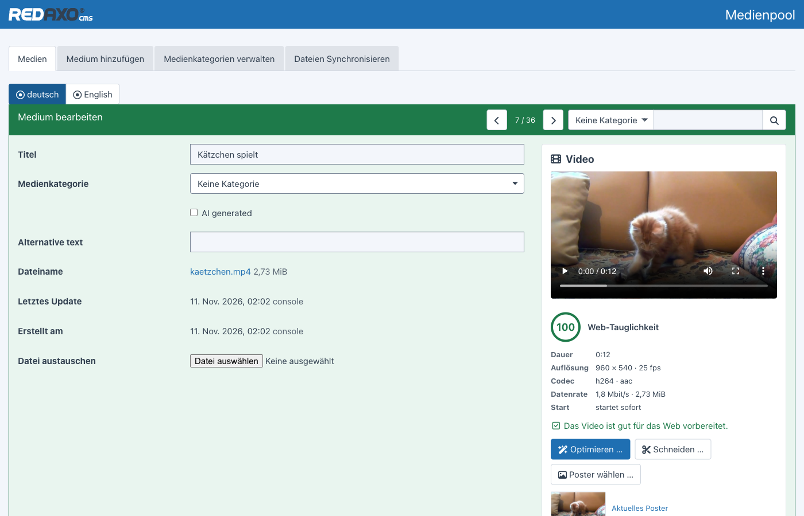
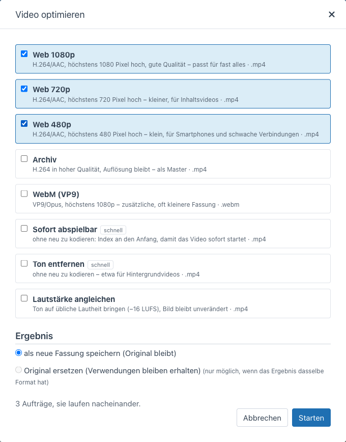
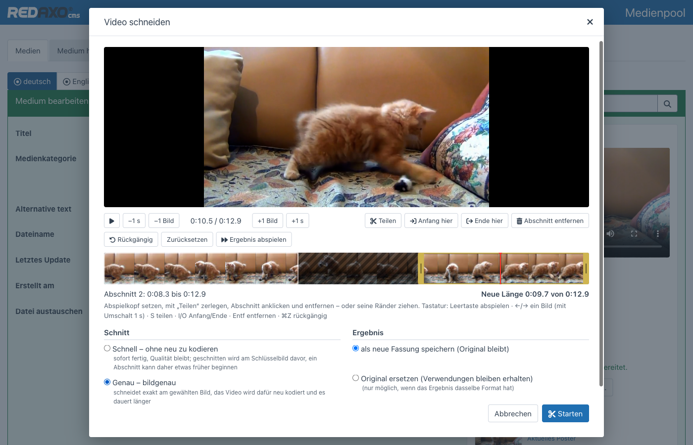
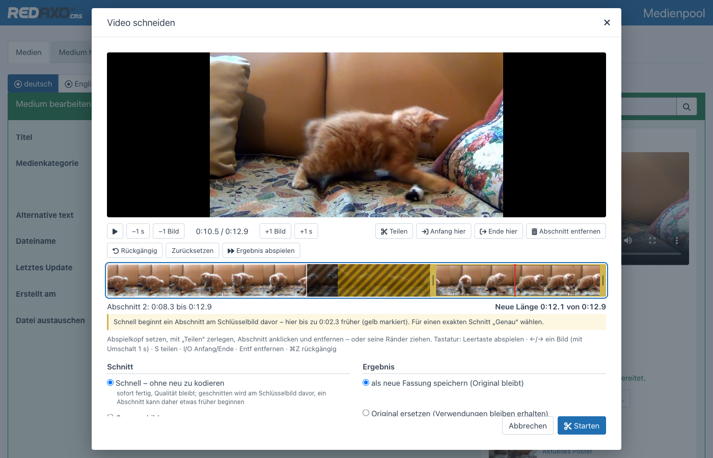
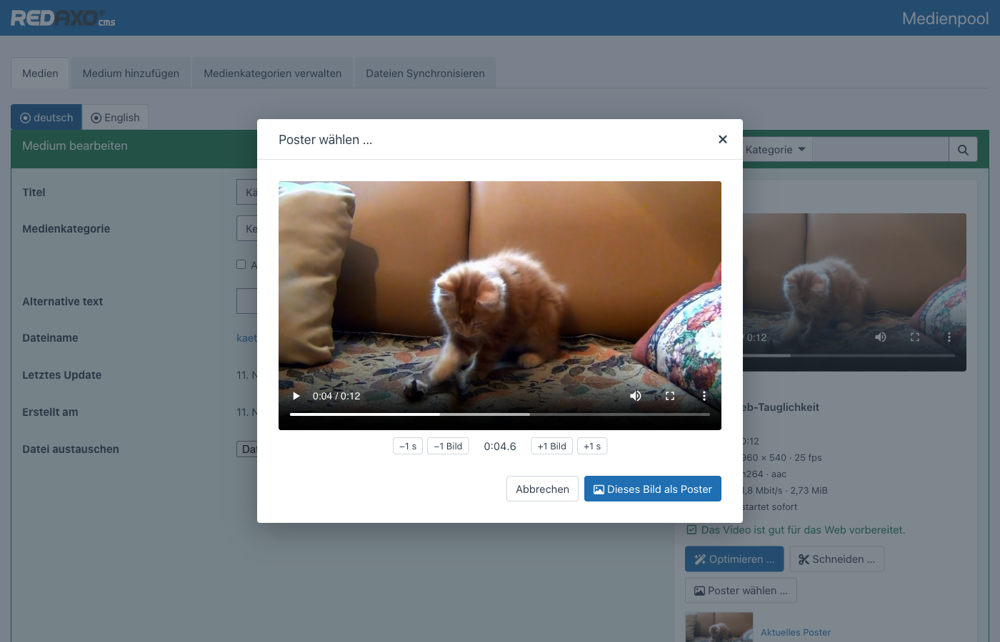

<p align="right">🌎 <a href="https://github.com/FriendsOfREDAXO/video_editor/blob/main/README.md">English</a></p>

# Video-Editor für REDAXO 6

Videos direkt im Medienpool bearbeiten: **analysieren**, **für das Web optimieren**, **schneiden** und ein **Poster**
wählen – mit ffmpeg, als Aufträge im Hintergrund. Das Gegenstück zum [Image-Editor](https://github.com/FriendsOfREDAXO/image_editor).



- **Analyse** – Auflösung, Codecs, Dauer, Datenrate, ob das Video sofort startet; dazu eine Bewertung der
  Web-Tauglichkeit mit Empfehlungen, die sich mit einem Klick anwenden lassen
- **Optimieren** – Vorlagen für das Web (1080p, 720p, 540p, WebM), Archiv, sofort abspielbar, Ton entfernen,
  Lautstärke angleichen
- **Schneiden** – Zeitleiste mit Vorschaubildern, teilen, Abschnitte entfernen, Ränder ziehen; schnell ohne Neukodierung
  oder bildgenau
- **Poster** – Standbild auf das Bild genau wählen
- **Ergebnis** als neue, verknüpfte Fassung oder anstelle des Originals – Verwendungen bleiben erhalten
- **Aufträge im Hintergrund** mit Fortschritt, Abbrechen und erneut Versuchen; immer nur einer zur Zeit
- **Rechte** in drei Stufen: ansehen, bearbeiten, Original ersetzen

> Die Neuentwicklung für REDAXO 6 übernimmt Ideen aus dem AddOn [ffmpeg](https://github.com/FriendsOfREDAXO/ffmpeg) für
> REDAXO 5. Untertitel (WebVTT) folgen in einer der nächsten Versionen.

## Installation

```bash
composer require friendsofredaxo/video_editor:1.x-dev
php bin/console migrate
```

Voraussetzungen auf dem Server:

- **ffmpeg** und **ffprobe** (ab Version 4.4) – gesucht werden sie im `PATH` und in den üblichen Ordnern (`/usr/bin`,
  `/usr/local/bin`, `/opt/homebrew/bin` …)
- **PHP für die Kommandozeile**, damit Aufträge im Hintergrund laufen (`exec` erlaubt). Ohne arbeitet der Video-Editor den
  Auftrag nach der Antwort des Requests ab, zusätzlich holt der Cronjob `video_editor_work` Liegengebliebenes nach.

Liegen die Programme woanders, lassen sie sich per Umgebungsvariable (z. B. in `.env`) oder in der Konfiguration des
AddOns angeben:

| Umgebungsvariable | Konfiguration | Bedeutung |
| --- | --- | --- |
| `FFMPEG_BIN` | `ffmpeg_path` | Pfad zu ffmpeg |
| `FFPROBE_BIN` | `ffprobe_path` | Pfad zu ffprobe |
| `PHP_CLI` | `php_cli` | PHP für die Kommandozeile (unter PHP-FPM wird es sonst neben dem FPM-Programm gesucht) |
| – | `timeout` | Höchstdauer eines Auftrags in Sekunden (Standard 3600) |

## Analyse

Das Panel erscheint in der Detailansicht jedes Videos im Medienpool (MP4, M4V, MOV, WebM, MKV, OGV, AVI). Es zeigt eine
Vorschau und die wichtigsten Daten und bewertet, wie gut sich das Video für das Web eignet – von 0 bis 100. Abzüge gibt es
für Codecs, die Browser nicht (H.265) oder kaum abspielen, für zu große Auflösungen, hohe Datenraten, Videos, die erst
nach dem vollständigen Laden starten, und für ungeeignete Formate. Zu jedem Hinweis gibt es eine passende Vorlage.

## Optimieren



| Vorlage | Ergebnis |
| --- | --- |
| Web 1080p | H.264/AAC, höchstens 1080 Pixel hoch – passt für fast alles |
| Web 720p | H.264/AAC, höchstens 720 Pixel hoch – für Inhaltsvideos |
| Mobil 540p | H.264/AAC, höchstens 540 Pixel hoch – für schwache Verbindungen |
| Archiv | H.264 in hoher Qualität, Auflösung bleibt |
| WebM (VP9) | VP9/Opus, höchstens 1080p – zusätzliche, oft kleinere Fassung |
| Sofort abspielbar | ohne Neukodierung: Index an den Anfang (`faststart`) |
| Ton entfernen | ohne Neukodierung – etwa für Hintergrundvideos |
| Lautstärke angleichen | Ton auf −16 LUFS, Bild unverändert |

Verkleinert wird nie über die Auflösung des Originals hinaus. Das Ergebnis wird als **neue Fassung** im Medienpool
angelegt und mit dem Original verknüpft – oder es **ersetzt das Original**, sofern das Format gleich bleibt.

## Schneiden



Abspielkopf setzen, mit **Teilen** zerlegen, Abschnitt anklicken und **entfernen** – oder seine Ränder ziehen.
**Ergebnis abspielen** springt über die entfernten Teile, die neue Länge steht darunter.

| Taste | Wirkung |
| --- | --- |
| Leertaste | abspielen / anhalten |
| ← → | ein Bild zurück / vor (mit ⇧ eine Sekunde) |
| Pos1 / Ende | an den Anfang / ans Ende |
| S | am Abspielkopf teilen |
| I / O | Anfang / Ende des gewählten Abschnitts hierher |
| Entf | Abschnitt entfernen |
| ⌘Z / Strg+Z | rückgängig |

Zwei Arten zu schneiden:

- **Genau** – bildgenau, das Video wird dafür neu kodiert (H.264/AAC, bei WebM VP9/Opus)
- **Schnell** – ohne Neukodierung, sofort fertig und ohne Qualitätsverlust. Ein Abschnitt kann dann aber nur an einem
  Schlüsselbild beginnen. Der Editor zeigt die Schlüsselbilder auf der Zeitleiste und gelb, was dadurch zusätzlich
  mitkommt; bliebe so nichts herausgeschnitten, empfiehlt er „Genau“.



## Poster



Stelle im Video suchen, mit „±1 Bild“ genau treffen, übernehmen: Das Standbild landet als JPEG im Medienpool, in derselben
Kategorie, und ist mit dem Video verknüpft. Ein neues Poster ersetzt die Datei des bisherigen – wo es verwendet wird,
erscheint gleich das neue.

## Aufträge

Optimieren und Schneiden laufen als Aufträge: Der Video-Editor startet `php bin/console video:work` im Hintergrund, die
Seite zeigt den Fortschritt. Es läuft immer nur ein Auftrag zur Zeit (Sperrdatei), damit der Server nicht überlastet
wird. Hängen gebliebene Aufträge (etwa nach einem Absturz) werden freigegeben, erledigte nach 30 Tagen gelöscht.

```bash
php bin/console video:work              # wartende Aufträge abarbeiten (höchstens 55 Minuten)
php bin/console video:work --seconds=60
```

Der Cronjob `video_editor_work` (jede Minute) holt nach, was liegen geblieben ist – nützlich, wenn `exec` gesperrt ist.

## Rechte

| Wer | Darf |
| --- | --- |
| jeder mit Zugriff auf die Medienkategorie | Vorschau, Analyse, Aufträge und Fassungen ansehen |
| `video_editor[]` | optimieren (als neue Fassung), schneiden, Poster wählen, Aufträge abbrechen und neu starten |
| zusätzlich `video_editor[replace]` (Optionen) | das Original durch das Ergebnis ersetzen |
| Admins | alles |

Das Medienrecht für die Kategorie gilt immer: Auch mit `video_editor[]` bleibt ein Video aus einer fremden Kategorie
gesperrt. Geprüft wird auf dem Server, die Oberfläche blendet nur aus, was nicht erlaubt ist.

## Für Entwickler

Poster und Web-Fassungen eines Videos für eigene Templates und Module:

```php
use FriendsOfRedaxo\VideoEditor\VideoEditor;

$poster = VideoEditor::poster('film.mov');          // Media|null – zuletzt gewähltes Poster
foreach (VideoEditor::sources('film.mov') as $s) {  // beste Quelle zuerst: WebM, MP4-Web-Fassung, sonst Original
    echo '<source src="' . $s['url'] . '" type="' . $s['type'] . '">';
}
VideoEditor::sources('film.mov', small: true);      // 720p vor 1080p, z. B. für Hintergrundvideos
VideoEditor::editUrl('film.mov');                   // Bearbeiten im Medienpool – null ohne Recht
```

Wer den Video-Editor nur nutzen will, wenn er installiert ist, prüft vorher
`class_exists(\FriendsOfRedaxo\VideoEditor\VideoEditor::class)`.

### fluid

[fluid](https://github.com/FriendsOfREDAXO/fluid) braucht den Video-Editor nicht, nutzt ihn aber, wenn er da ist: Der
Block „Video“ zeigt ohne eigenes Vorschaubild das hier gewählte Poster und liefert die Web-Fassungen aus, das
Hintergrundvideo im Hero nimmt die kleinere Fassung, und das Medienfeld bekommt bei Videos den Knopf „Video bearbeiten“.

## Technik

- ffmpeg ausschließlich mit Argumentlisten über `proc_open` – ohne Shell, alle Eingaben geprüft
- Fortschritt über `-progress`, Abbrechen beendet ffmpeg (erst SIGTERM, dann SIGKILL)
- der Editor holt das Video über einen eigenen Endpunkt mit Range-Anfragen, damit der Browser auch dann springen kann,
  wenn der Webserver `/media` ohne Range ausliefert
- Dialoge und Farben des Cores, hell und dunkel; keine Inline-Styles und -Handler (Content-Security-Policy des Backends)

## Tests

Die Integrationstests prüfen die Rechte (ansehen, bearbeiten, ersetzen, fremde Kategorie). Sie brauchen eine
REDAXO-Installation mit Datenbank und ffmpeg, legen eigene Testdaten an (alles mit „ve-test“ im Namen, kurze Videos
erzeugt ffmpeg) und räumen danach auf:

```bash
REDAXO_BOOTSTRAP=/pfad/zu/redaxo/.tools/bootstrap.php vendor/bin/phpunit -c /pfad/zu/video_editor/phpunit.dist.xml
```

## Autor

**Thomas Skerbis** ([skerbis](https://github.com/skerbis)) für [Friends Of REDAXO](https://friendsofredaxo.github.io)

Beispielvideo in den Screenshots: [Kätzchen](https://pixabay.com/videos/kitten-game-pets-4216/) von Pixabay.

## Lizenz

MIT, siehe [LICENSE](LICENSE).
