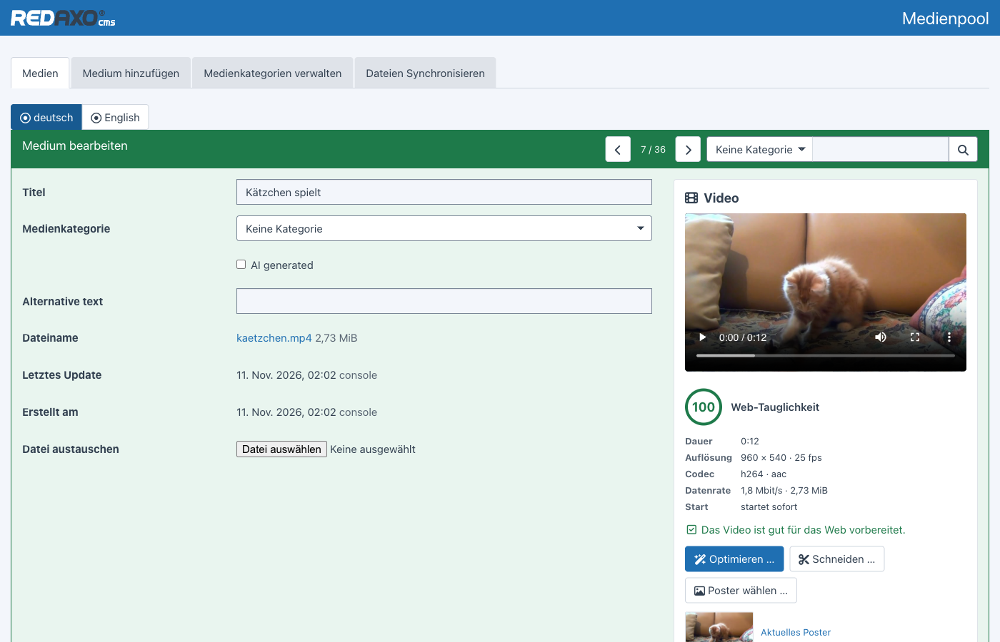
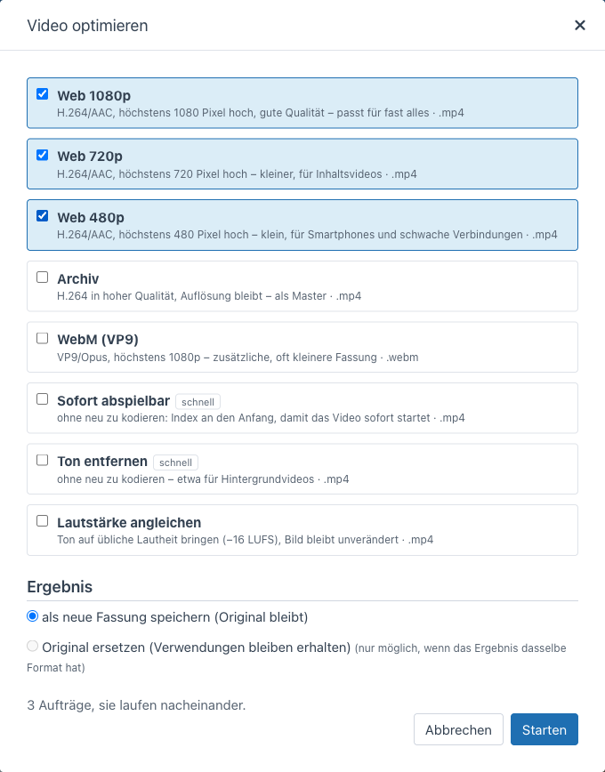
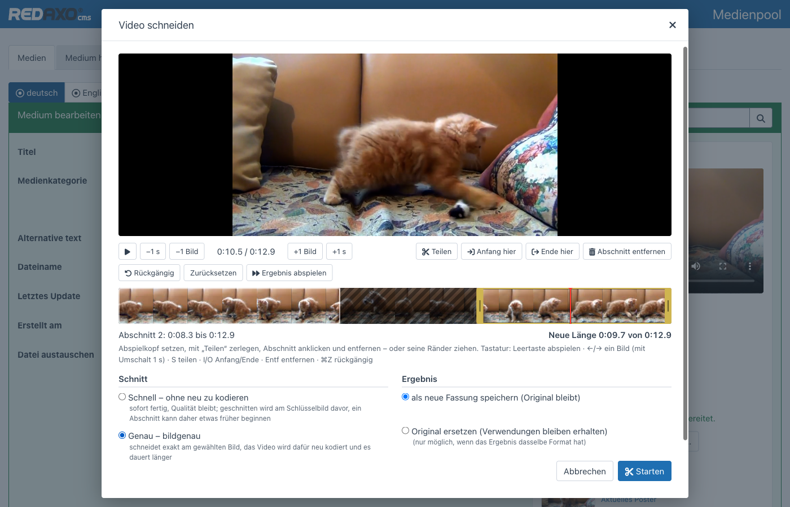
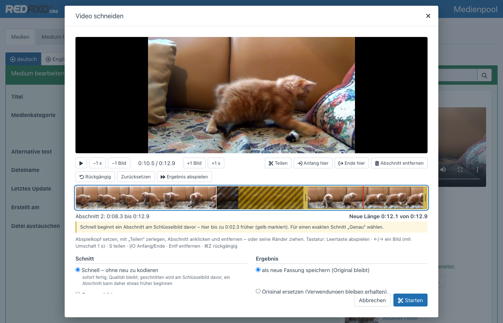
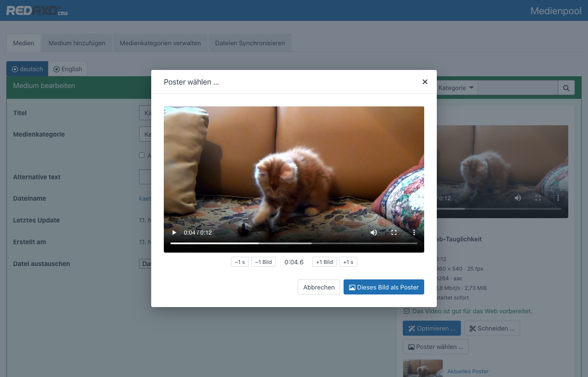

<p align="right">🌎 <a href="https://github.com/FriendsOfREDAXO/video_editor/blob/main/README.de.md">Deutsch</a></p>

# Video Editor for REDAXO 6

Edit videos right in the media pool: **analyse**, **optimize for the web**, **trim** and pick a **poster** – with ffmpeg,
as jobs in the background. The counterpart to the [Image Editor](https://github.com/FriendsOfREDAXO/image_editor).



- **Analysis** – resolution, codecs, duration, bitrate, whether the video starts right away; plus a web readiness score
  with recommendations you can apply with one click
- **Optimize** – presets for the web (1080p, 720p, 540p, WebM), archive, instant playback, remove audio, normalize
  loudness
- **Trim** – timeline with thumbnails, split, remove sections, drag edges; fast without re-encoding or frame-accurate
- **Poster** – pick a still frame down to the exact frame
- **Result** as a new, linked version or in place of the original – where it is used stays intact
- **Background jobs** with progress, cancel and retry; only one at a time
- **Permissions** in three levels: view, edit, replace the original

> This rewrite for REDAXO 6 takes ideas from the [ffmpeg](https://github.com/FriendsOfREDAXO/ffmpeg) addon for
> REDAXO 5. Subtitles (WebVTT) will follow in one of the next versions. The screenshots show the German backend.

## Installation

```bash
composer require friendsofredaxo/video_editor:1.x-dev
php bin/console migrate
```

Server requirements:

- **ffmpeg** and **ffprobe** (4.4 or newer) – looked up in `PATH` and the usual folders (`/usr/bin`, `/usr/local/bin`,
  `/opt/homebrew/bin` …)
- **PHP for the command line**, so jobs can run in the background (`exec` allowed). Without it the video editor processes
  the job after the response has been sent; in addition the cronjob `video_editor_work` picks up anything left over.

If the programs live elsewhere, set them as environment variables (e.g. in `.env`) or in the addon configuration:

| Environment variable | Configuration | Meaning |
| --- | --- | --- |
| `FFMPEG_BIN` | `ffmpeg_path` | path to ffmpeg |
| `FFPROBE_BIN` | `ffprobe_path` | path to ffprobe |
| `PHP_CLI` | `php_cli` | PHP for the command line (under PHP-FPM it is otherwise looked up next to the FPM binary) |
| – | `timeout` | maximum duration of a job in seconds (default 3600) |

## Analysis

The panel appears in the detail view of every video in the media pool (MP4, M4V, MOV, WebM, MKV, OGV, AVI). It shows a
preview and the key facts and rates how well the video suits the web – from 0 to 100. Points are deducted for codecs
browsers don't (H.265) or hardly play, oversized resolutions, high bitrates, videos that only start once fully loaded,
and unsuitable formats. Every hint comes with a matching preset.

## Optimize



| Preset | Result |
| --- | --- |
| Web 1080p | H.264/AAC, at most 1080 pixels high – fits almost everything |
| Web 720p | H.264/AAC, at most 720 pixels high – for content videos |
| Mobile 540p | H.264/AAC, at most 540 pixels high – for slow connections |
| Archive | H.264 in high quality, resolution unchanged |
| WebM (VP9) | VP9/Opus, at most 1080p – additional, often smaller version |
| Instant playback | without re-encoding: index moved to the start (`faststart`) |
| Remove audio | without re-encoding – e.g. for background videos |
| Normalize loudness | audio to −16 LUFS, picture unchanged |

Videos are never scaled up beyond the original resolution. The result is added as a **new version** in the media pool and
linked to the original – or it **replaces the original** if the format stays the same.

## Trim



Set the playhead, **split**, click a section and **remove** it – or drag its edges. **Play result** skips the removed
parts, the new length is shown below.

| Key | Action |
| --- | --- |
| Space | play / pause |
| ← → | one frame back / forward (with ⇧ one second) |
| Home / End | to the start / end |
| S | split at the playhead |
| I / O | move start / end of the selected section here |
| Del | remove section |
| ⌘Z / Ctrl+Z | undo |

Two ways to cut:

- **Exact** – frame-accurate; the video is re-encoded (H.264/AAC, VP9/Opus for WebM)
- **Fast** – without re-encoding, done instantly and without quality loss. A section can only start at a keyframe,
  though. The editor shows the keyframes on the timeline and marks in yellow what comes along as a result; if nothing
  would be removed that way, it recommends “Exact”.



## Poster



Find the spot, hit it exactly with “±1 frame”, take it: the still lands as a JPEG in the media pool, in the same category,
linked to the video. A new poster replaces the file of the previous one – wherever it is used, the new one shows up
right away.

## Jobs

Optimizing and trimming run as jobs: the video editor starts `php bin/console video:work` in the background, the page
shows the progress. Only one job runs at a time (lock file) so the server isn't overloaded. Stuck jobs (e.g. after a
crash) are released, finished ones deleted after 30 days.

```bash
php bin/console video:work              # process waiting jobs (at most 55 minutes)
php bin/console video:work --seconds=60
```

The cronjob `video_editor_work` (every minute) catches up on anything left over – useful when `exec` is disabled.

## Permissions

| Who | May |
| --- | --- |
| anyone with access to the media category | view preview, analysis, jobs and versions |
| `video_editor[]` | optimize (as a new version), trim, pick a poster, cancel and retry jobs |
| additionally `video_editor[replace]` (options) | replace the original with the result |
| admins | everything |

The media category permission always applies: even with `video_editor[]` a video in a foreign category stays locked.
Checks happen on the server; the interface only hides what isn't allowed.

## For developers

Poster and web versions of a video for your own templates and modules:

```php
use FriendsOfRedaxo\VideoEditor\VideoEditor;

$poster = VideoEditor::poster('film.mov');          // Media|null – most recently picked poster
foreach (VideoEditor::sources('film.mov') as $s) {  // best source first: WebM, MP4 web version, else the original
    echo '<source src="' . $s['url'] . '" type="' . $s['type'] . '">';
}
VideoEditor::sources('film.mov', small: true);      // 720p before 1080p, e.g. for background videos
VideoEditor::editUrl('film.mov');                   // edit in the media pool – null without permission
```

To use the video editor only when it is installed, check
`class_exists(\FriendsOfRedaxo\VideoEditor\VideoEditor::class)` first.

### fluid

[fluid](https://github.com/FriendsOfREDAXO/fluid) doesn't need the video editor but uses it when present: the “Video”
block shows the poster picked here when no preview image is set and delivers the web versions, the hero background video
takes the smaller version, and the media field gets a “Edit video” button for videos.

## Technology

- ffmpeg exclusively with argument lists via `proc_open` – no shell, all input validated
- progress via `-progress`; cancelling stops ffmpeg (SIGTERM first, then SIGKILL)
- the editor loads the video through its own endpoint with range requests, so the browser can seek even when the web
  server delivers `/media` without range support
- dialogs and colours of the core, light and dark; no inline styles or handlers (backend Content Security Policy)

## Tests

The integration tests check the permissions (view, edit, replace, foreign category). They need a REDAXO installation with
a database and ffmpeg, create their own test data (everything named “ve-test”, short videos generated by ffmpeg) and clean
up afterwards:

```bash
REDAXO_BOOTSTRAP=/path/to/redaxo/.tools/bootstrap.php vendor/bin/phpunit -c /path/to/video_editor/phpunit.dist.xml
```

## Author

**Thomas Skerbis** ([skerbis](https://github.com/skerbis)) for [Friends Of REDAXO](https://friendsofredaxo.github.io)

Sample video in the screenshots: [kitten](https://pixabay.com/videos/kitten-game-pets-4216/) from Pixabay.

## License

MIT, see [LICENSE](LICENSE).
